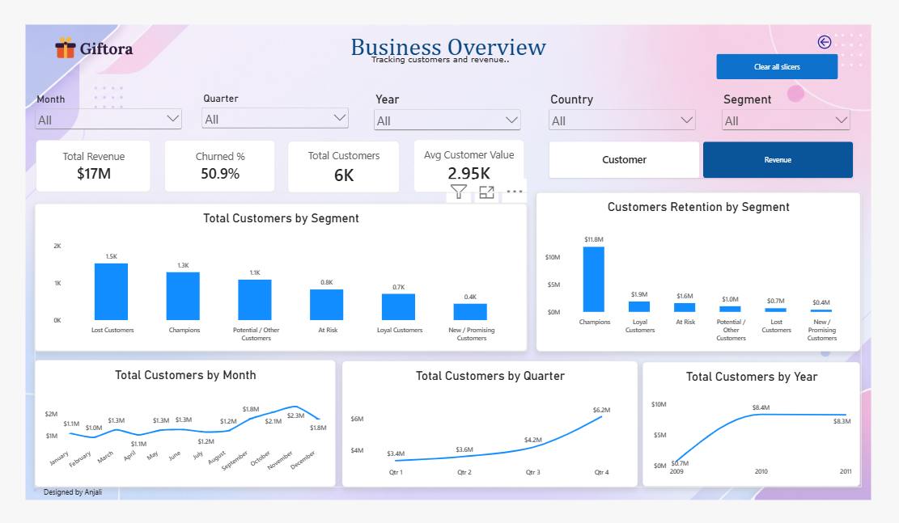

# Giftora-Customer-Analytics

An end-to-end customer analytics project for Giftora, a fictional gifting company, built with MySQL, Python and Power BI. It uses RFM segmentation to find the customers who bring the most revenue and the ones about to leave.

## Project Overview

Giftora is a fictional gifting company that sells to customers in several countries. This project analyses its customer and sales data to answer three things:

## Business Problem

The business wants to identify its most valuable customers and reduce churn among customers who are at risk of leaving.

## Business Questions Answered

1.Who are our most valuable customers, and how much revenue do they actually contribute?

2.Which customers are at risk of churning?

3.How does customer value and retention trend across time, by month, quarter, and year?

4.How does customer value and churn differ across geographic markets?

## Data Source

The project uses the Online Retail II dataset from the UCI Machine Learning Repository, donated by Daqing Chen. It is a real, anonymized transactional dataset from a UK-based, non-store online retailer that sells all-occasion giftware. It covers December 2009 to December 2011 and holds 1,067,371 raw transaction rows across two sheets. The dataset is licensed under Creative Commons Attribution 4.0 International (CC BY 4.0). "Giftora" is a fictional brand name used for this portfolio project, while the data itself is real.

## Tools and Tech Stack

| Tool | Purpose in this project |
|---|---|
| MySQL Server / MySQL Workbench | Data import, cleaning, deduplication, and exploratory querying on the full 1M+ row dataset |
| Python (pandas) | RFM calculation, customer scoring, segmentation logic, and churn flagging |
| Jupyter Notebook | Interactive development environment for the Python analysis |
| Power BI Desktop | Two-page interactive dashboard: Business Overview and RFM Analysis |
| DAX | Measures for customer counts, revenue totals, churn percentage, and average customer value |

## Project Workflow

Step 1 : Business Requirements Document. Defined a general scope, business questions before any data work began.

Step 2 : SQL, Data Cleaning and Exploration. Imported both raw sheets into MYSQL Server, corrected data types, resolved a mixed date format issue affecting over half the dataset, removed 32,907 exact duplicate rows, and validated row counts at every step against the published UCI total.

Step 3 : Python, RFM Segmentation. Loaded the cleaned data into pandas, calculated Recency, Frequency, and Monetary value per customer, scored each customer on a 1 to 5 scale per dimension, and assigned each of the 5,881 customers to one of six segments. Added a 90 day churn flag.

Step 4 : Power BI, Dashboard Build. The final scored table was loaded into Power BI, and DAX measures were created for Total Customers, Total Revenue, Churned % and Avg Customer Value. Two interactive dashboards were built: Business Overview, which tracks customers and revenue with a Customer / Revenue toggle, and RFM Analysis, which shows segment and country performance and churn trends with a Segment / Country toggle. Both pages share slicers, a "Clear all slicers" button and custom styling with the Giftora logo.

##  Project Walkthrough

### Sample SQL : Checking missing records

 
 
   
### Sample Python : Calculating Recency,Frequency and Monetary

  
  

###  Dashboard Screenshots

                    Business Overview by Customer
                    

                    Business Overview by Revenue
     

                    RFM Analysis by Segment
     

                    RFM Analysis by Country
     

 ###  Project Status

This project is still in progress. Two dashboards are complete so far, Business Overview and RFM Analysis. Next, I plan to build a **Home dashboard** that links to both pages through navigation buttons, so the whole report can be explored from one starting point. I will also keep exploring more features of Power BI and add them to this project as I learn.

###Author

 Anjali Kumari
